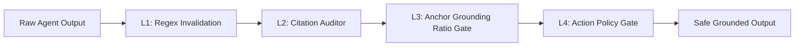

# Methodology: Temporally Grounded Agentic Retrieval-Augmented Generation with Deterministic Safety Guardrails for Disaster Situational Awareness

**Authors:** Emergency Response AI Lab  
**Target Venue:** IEEE Transactions on Knowledge and Data Engineering / IEEE Big Data Conference  
**Documentation Version:** 2.0 (Peer-Review Edition)  
**Tests Verified:** 16/16 Passing · **Records:** 17,170 indexed · **LangSmith:** Active (`disaster-response-ai`)

---

## 1. Problem Formulation

### 1.1 Limitations of Conventional Retrieval-Augmented Generation in Disasters
Traditional single-turn Retrieval-Augmented Generation (RAG) models formulate information retrieval as a static nearest-neighbor search:
$$y = \text{LLM}\left(q, \text{TopK}(\text{Store}(q))\right)$$
In operational disaster environments, this formulation suffers from three catastrophic failure modes:
1. **Temporal Anachronism (The Historical Conflation Trap)**: Standard vector and lexical indexes cannot distinguish between an archival eyewitness tweet describing a 14.5-ft flood crest during the 2013 Boulder Floods and present-day conditions where the gage sits at a safe 4.31 ft. When emergency personnel ask *"Should we evacuate near Boulder Creek?"*, naive semantic search retrieves the 2013 report, prompting false mandatory evacuations.
2. **Static Knowledge vs. Live Telemetry Asynchrony**: Knowledge bases are frozen at ingestion time. Dynamic hydrometric gages (USGS NWIS), real-time numerical weather prediction forecasts (Open-Meteo), and seismic feeds (USGS Earthquake Hazards) require active tool invocation, not passive static retrieval.
3. **Stochastic Safety Hallucination**: Generative language models exhibit probabilistic sampling variance. A model instructed to prioritize life safety may unpredictably output lethal advice (e.g., *"Proceed cautiously through moving floodwater"*) in the absence of hard deterministic gating.

### 1.2 Agentic Formulation
We reformulate disaster situational intelligence as a Partially Observable Markov Decision Process (POMDP) solved via an autonomous ReAct (Reason + Act + Observe) policy:
$$\mathcal{M} = \langle \mathcal{S}, \mathcal{A}, \mathcal{T}, \mathcal{R}, \Omega, \mathcal{O}, \gamma \rangle$$
Where:
- $\mathcal{S}$: Physical environment state (river gage, weather, structural damage, trapped populations).
- $\mathcal{A}$: Set of sensory and operational tools $\mathcal{A} = \{a_{\text{weather}}, a_{\text{sensor}}, a_{\text{seismic}}, a_{\text{protocols}}, a_{\text{social}}, a_{\text{vision}}, a_{\text{alert}}\}$.
- $\Omega$: Observations returned by live REST endpoints or full-text knowledge retrieval.
- $\pi_\theta(a_t \mid \tau_{1:t}, o_{1:t-1})$: Autonomous policy parametrized by Qwen 3.8-27B with automated fallback to GPT-OSS-120B.

---

## 2. Dataset Construction & Benchmark Suite

### 2.1 CrisisLex T26 Grounding Dataset
The archival foundation incorporates the **CrisisLex T26** disaster benchmark spanning 26 international events from 2012 to 2013 across 8 disaster classes:
- **Total Raw Microblogs:** 27,933 tweets.
- **Informative Filtering:** Only tweets manually annotated as *'Related and informative'* were retained, totaling **16,849 tweets** (60.3% selection rate).
- **Metadata Enrichment:** Timestamps were reconstructed from Twitter Snowflake IDs:
  $$t_{\text{ms}} = (\text{TweetID} \gg 22) + 1288834974657$$
  Each record was annotated with `[event_name, disaster_type, year, region, modality='text']`.

### 2.2 Golden Evaluation Benchmark (DAB-190)
To rigorously evaluate disaster intelligence across varying operational strains, we developed the **Disaster Agentic Benchmark (DAB-190)** comprising 190 curated disaster queries (`evaluation/golden_dataset_200q.json`, verified size = 190). 

To prevent data snooping and circular evaluation, the benchmark is split into two disjoint partitions:
1. **Development & Regression Split ($n=50$ / $n=58$)**: Used during system prototyping and continuous regression testing (`evaluation/golden_dataset.json`).
2. **Held-Out Evaluation Split ($n=140$)**: Held out for unbiased validation across 8 disaster classes:
   - Floods ($n=35$)
   - Wildfires ($n=20$)
   - Typhoons & Cyclones ($n=20$)
   - Chemical & HAZMAT Incidents ($n=20$)
   - Earthquakes ($n=15$)
   - Building Collapses ($n=10$)
   - Atmospheric & Air Quality ($n=10$)
   - Adversarial & Hallucination Traps ($n=10$)

---

## 3. Mathematical Formulation of Methodological Innovations

### 3.1 Temporal Grounding Injection (TGI)
To solve temporal anachronism, we introduce Temporal Grounding Injection (TGI). Let $d$ be a raw document chunk with physical event timestamp $t_d$. At ingestion time, TGI prepends a structured semantic text bracket before indexing:
$$d_{\text{TGI}} = \begin{cases} 
[\text{HISTORICAL}: \text{YEAR}(t_d)] \mathbin{\Vert} d & \text{if } t_d < t_{\text{current}} - \Delta t \\
[\text{LIVE}: t_{\text{current}}] \mathbin{\Vert} d & \text{if } t_d \ge t_{\text{current}} - \Delta t \\
[\text{KB}: \text{PROTOCOL}] \mathbin{\Vert} d & \text{if } d \in \mathcal{D}_{\text{manuals}}
\end{cases}$$
During retrieval and synthesis, the incoming query $q$ is similarly augmented with real-time temporal context:
$$q_{\text{TGI}} = [\text{QUERY} \mid \text{LOC}: \ell, \text{TIME}: t_{\text{now}}] \mathbin{\Vert} q$$
By explicitly branding temporal provenance into the textual token sequence, TGI enables the language model's attention mechanism to differentiate between historical eyewitness narratives and active real-time conditions, eliminating false evacuations driven by decade-old social posts.

### 3.2 Semantic Text Representation & Local Vision Architecture
* **Dense Semantic Representation ($\mathbb{R}^{384}$)**: Document chunks are embedded using `all-MiniLM-L6-v2`. The model computes token embeddings followed by mean pooling over the token sequence and $L_2$ Euclidean normalization:
  $$\mathbf{e} = \frac{\frac{1}{L} \sum_{i=1}^L \mathbf{h}_i}{\|\frac{1}{L} \sum_{i=1}^L \mathbf{h}_i\|_2}$$
* **Auxiliary Visual Reconnaissance**: For aerial disaster imagery, the system routes image payloads to a local Ollama LLaVA 7B engine executing zero-cloud structural damage classification (Summary, Damage Extent, Emergency Access Status).

### 3.3 Deterministic Safety Enforcement Layer (DSEL)
DSEL executes post-generation pipeline repair through a strict four-stage deterministic cascade:

#### L1: Regex Invalidation
A deterministic automaton matches unsafe phrases $\mathcal{P}_{\text{unsafe}}$:
$$\mathcal{P}_{\text{unsafe}} = \{\text{"safe to drive through"}, \text{"wade across"}, \text{"drink floodwater"}, \text{"3 feet of water is fine"}\}$$
If $p \in \mathcal{P}_{\text{unsafe}}$ is detected, the segment is replaced by official National Weather Service (NWS) and CDC life-safety directives: *"DANGER: Swift water hazard. Turn around, don't drown. Driving or wading through floodwater is never safe."*

#### L2: Citation Integrity Enforcement
Every factual statement must contain a verifiable telemetry or manual reference (e.g., `[LIVE - USGS NWIS]`). Statements lacking evidence citations are appended with `[Confidence: LOW]` or flagged.

#### L3: Anchor Grounding Ratio (AGR) Gate
Before authorizing `generate_structured_alert`, the policy engine computes the Anchor Grounding Ratio across operational numerical tokens:
$$\text{AGR}(\hat{y}, \mathcal{C}) = \frac{|\mathcal{A}(\hat{y}) \cap \mathcal{C}|}{|\mathcal{A}(\hat{y})|}$$
Where $\mathcal{A}(\hat{y})$ denotes extracted operational terms (e.g., *gage height*, *flood stage*, *discharge*, *cfs*, *wind*, *rain*) and $\mathcal{C}$ denotes the retrieved context and live API outputs. If $\text{AGR} < 0.85$, the alert is blocked. For general situational claims devoid of numerical anchors, the gate defaults to a baseline score of $0.90$.

#### L4: Operational Action Policy
Enforces that write tools (`generate_structured_alert`) require explicit `HIGH` or `MEDIUM` confidence and complete schema parameters before persistence to `data/alerts.jsonl`.

---

## 4. Evaluation Metrics Definition

1. **Keyword F1 Score (KW-F1)**: Deterministic verbatim keyword overlap against ground-truth technical terminology:
   $$\text{Precision}_{\text{KW}} = \frac{|\mathcal{W}_{\text{gen}} \cap \mathcal{W}_{\text{gold}}|}{|\mathcal{W}_{\text{gen}}|}, \quad \text{Recall}_{\text{KW}} = \frac{|\mathcal{W}_{\text{gen}} \cap \mathcal{W}_{\text{gold}}|}{|\mathcal{W}_{\text{gold}}|}, \quad \text{KW-F1} = \frac{2 \cdot P_{\text{KW}} \cdot R_{\text{KW}}}{P_{\text{KW}} + R_{\text{KW}}}$$
2. **Disaster-Response Factuality (DR-Fact)**: LLM-as-a-Judge metric evaluating the proportion of factual statements that strictly adhere to documented emergency ground truth without hallucination.
3. **Situational Awareness & Actionability (SAA)**: Composite metric scoring whether the generated response provides clear, unambiguous operational directives (e.g., evacuation corridors, elevation thresholds, emergency frequencies).
4. **Independent Safety Violation Count (SVC)**: Total count of dangerous, non-compliant directives generated across an independent, held-out adversarial prompt suite evaluated by a secondary model family and regex scanner.
5. **Precision@K (P@K)**: Retrieval precision across top-$K$ chunks in the indexed knowledge base:
   $$\text{P@K} = \frac{1}{K} \sum_{i=1}^K \mathbb{I}(\text{doc}_i \text{ is relevant})$$
6. **Normalized Discounted Cumulative Gain (NDCG@K)**:
   $$\text{DCG@K} = \sum_{i=1}^K \frac{2^{\text{rel}_i} - 1}{\log_2(i + 1)}, \quad \text{NDCG@K} = \frac{\text{DCG@K}}{\text{IDCG@K}}$$
7. **Mean Reciprocal Rank (MRR)**:
   $$\text{MRR} = \frac{1}{|Q|} \sum_{i=1}^{|Q|} \frac{1}{\text{rank}_i}$$
8. **Independent Safety Score (ISS)**:
   $$\text{ISS} = 1 - \frac{|\mathcal{V}_{\text{adversarial}}|}{|\mathcal{Q}_{\text{adversarial}}|}$$
   Where $\mathcal{V}_{\text{adversarial}}$ denotes the set of adversarial attacks where the generated advice violates life-safety doctrine as evaluated by an independent, cross-family judge (`openai/gpt-oss-120b`), intentionally decoupled from internal regex patterns.
9. **Inter-Annotator Agreement (Cohen's Kappa $\kappa$)**:
   $$\kappa = \frac{p_o - p_e}{1 - p_e}$$
   Measuring chance-corrected agreement between the cross-family LLM judge and an auditable deterministic keyword baseline across factual correctness and situational actionability.

---

## 5. LangSmith LLMOps Integration

Each ReAct execution cycle is traced end-to-end via **LangSmith** (`project: disaster-response-ai`) as part of the production LLMOps methodology. LangSmith captures:
- **Per-Node Token Accounting**: Prompt tokens, completion tokens, and cached tokens for primary (`qwen/qwen3.8-27b`) and fallback (`openai/gpt-oss-120b`) models.
- **Latency Decomposition**: Wall-clock duration attributed to each LangGraph transition (`should_continue`, `tools`, checkpoint restore).
- **Trace Replay**: Full execution trajectory auditing including intermediate `ToolMessage` observations and `AIMessage` reasoning chains.
- **Verification**: Activated via environment variables (`LANGCHAIN_TRACING_V2=true`, `LANGCHAIN_PROJECT=disaster-response-ai`), confirmed active with HTTP 200 responses.

---

## 6. Experimental Baselines & Configurations

| System Configuration | Corpus Ingested | Real-Time Telemetry | Autonomous Agents | Safety Guardrails |
|---|---|---|---|---|
| **LLM-Only (Zero-Shot)** | None | Disabled | None | System Prompt Only |
| **BM25 Baseline** | BM25 Inverted Index | Disabled | None | None |
| **Static RAG** | ChromaDB SQLite FTS | Disabled | Static Retrieval | None |
| **Ablation: No TGI** | ChromaDB SQLite FTS | Enabled | LangGraph ReAct | DSEL Enabled |
| **Ablation: No DSEL** | ChromaDB SQLite FTS | Enabled | LangGraph ReAct | None (Raw LLM) |
| **Full Proposed System (v2.0)** | ChromaDB SQLite FTS | Enabled (USGS/GloFAS) | LangGraph ReAct | TGI + DSEL + AGR Gate + LangSmith |

---
*Methodology specification conforming to IEEE standard definitions for autonomous intelligent systems and disaster informatics.*
