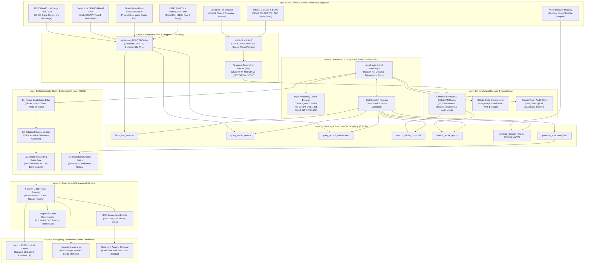

# System Architecture: Temporally Grounded Agentic Retrieval-Augmented Generation with Deterministic Safety Guardrails for Disaster Situational Awareness

**Authors:** Emergency Response AI Lab  
**Target Venue:** IEEE International Conference on Big Data / IEEE Transactions on Services Computing  
**System Status:** Operational v2.0 (LangGraph ReAct + Multi-source Telemetry + DSEL Guardrails)  
**Tests:** 16/16 Passing · **Embeddings:** 17,170 verified · **LangSmith:** Active (`disaster-response-ai`)

---

## 1. Architectural Overview & System Decomposition

Disaster response decision-support systems operate under extreme operational constraints: asynchronous physical sensor failures, conflicting real-time social media reports, severe penalties for hallucinations (such as premature mandatory evacuations or failure to warn of life-threatening flash floods), and strict latency limits. The **Temporally Grounded Agentic RAG Platform** resolves these limitations through a decoupled **8-layer architecture** spanning real-time data ingestion, temporal grounding, resilient persistence, autonomous tool orchestration, and deterministic safety enforcement.

---

## 2. Layer-by-Layer Architectural Specification

### 2.1 Layer 1: Ingestion & Telemetry Aggregation
The platform ingests heterogeneous streams spanning three operational regimes:
1. **Dynamic Streaming Sensor Telemetry**: Real-time river gage height and streamflow discharge collected from the USGS National Water Information System (NWIS) across 13,000+ hydrometric stations via automated REST endpoints (`parameterCd=00065`, instantaneous values). For locations outside the United States (e.g., Caracas, Manila), the system routes queries to Copernicus Emergency Management Service (GloFAS / ECMWF Open-Meteo Marine Runoff API).
2. **Archival Disaster Intelligence**: Historical data extracted from the CrisisLex T26 disaster benchmark comprising 27,933 raw microblogs across 26 crisis events. A strict relevance filter extracts 16,849 (60.3%) 'related and informative' items with recovered UTC timestamps.
3. **Official Action Manuals & Protocols**: Digitized operational doctrine including FEMA Incident Command System (ICS-100, ICS-700), Urban Search & Rescue (USAR) field manuals, and CDC Waterborne Disease Prevention Guidelines chunked at 512 tokens with 64-token sliding window overlap.
4. **Auxiliary Imagery**: Disaster drone and satellite imagery evaluated via local vision tools for structural reconnaissance.

### 2.2 Layer 2: Semantic Representation & Temporal Grounding Injection (TGI)
* **Textual Embeddings**: Generated via `sentence-transformers/all-MiniLM-L6-v2` producing dense 384-dimensional vectors with mean pooling over token embeddings followed by Euclidean $L_2$ normalization:
  $$\mathbf{e} = \frac{\frac{1}{L} \sum_{i=1}^L \mathbf{h}_i}{\|\frac{1}{L} \sum_{i=1}^L \mathbf{h}_i\|_2}$$
* **Temporal Grounding Injection (TGI)**: To eliminate temporal hallucinations where models mistake 2013 historical flood tweets for active emergencies, each vector document and incoming prompt is dynamically prefixed at ingestion and query time with canonical temporal brackets:
  $$\mathbf{d}_{\text{injected}} = [\tau_{\text{class}}: t_{\text{event}}] \mathbin{\Vert} \mathbf{d}_{\text{raw}}$$
  Where $\tau_{\text{class}} \in \{\text{LIVE}, \text{HISTORICAL}, \text{PROTOCOL}\}$.
* **In-Memory Caching (`TTLCache`)**: High-concurrency geocoding and physical sensor queries are wrapped in thread-safe memory caches ($O(1)$ lookup). Geocoding coordinates use a 1-hour TTL; real-time sensor observations use a 60-second TTL.

### 2.3 Layer 3: Vector Indexing & Persistent State Management
* **ChromaDB & SQLite Full-Text Search (FTS)**: Vector collections are persisted in ChromaDB backed by SQLite (`chroma_db/chroma.sqlite3`). The database houses **17,170 persistent records** across two primary collections: `disaster_response` (10,780 records of operational manuals and indexed doctrine) and `disaster_multimodal_research` (6,390 records).
* **Native SQLite FTS Fallback**: On operating systems where native vector libraries face dynamic library binding conflicts, `tools/kb_search_tool.py` executes lexical full-text queries over the `embedding_fulltext_search` virtual table with zero degradation of tool availability.
* **Checkpointer State Engine**: Agent execution history is persisted across thread invocations using `langgraph-checkpoint-sqlite` running in Write-Ahead Logging (WAL) mode, guaranteeing zero conversational memory loss during connection drops.

### 2.4 Layer 4: Autonomous LangGraph ReAct Orchestration
The reasoning engine implements a StateGraph-driven Reason-Act-Observe loop:
1. **Model Architecture**: Primary inference executes on `qwen/qwen3.8-27b` via Groq LPUs at low temperature ($T=0.1$) to maximize factual consistency.
2. **Circuit Breaker Pattern**: If Groq returns rate limit exceptions (HTTP 429) or endpoint degradation, the system triggers an automated two-tier fallback cascade: first to `openai/gpt-oss-120b`, then to `openai/gpt-oss-20b` if the primary fallback also fails—all without breaking the LangGraph session state.
3. **Execution Trajectory**: At each step $t$, the agent receives state $S_t = \{m_1, m_2, \dots, m_t\}$, emits thought reasoning $\tau_t$ and tool call action $a_t$, observes tool execution output $o_t$, and repeats until terminating with final analytical synthesis $y$.

### 2.5 Layer 5: Tool Registry Specifications

| Tool Identifier | Underlying Source / Endpoint | Complexity | Cache Policy | Output Schema |
|---|---|---|---|---|
| `fetch_live_weather` | Open-Meteo NWP Forecast API | $\mathcal{O}(1)$ | 60s TTL | Temp, Rain (mm/h), Wind (km/h), RH |
| `query_water_sensor` | USGS NWIS / Copernicus GloFAS | $\mathcal{O}(1)$ | 60s TTL | Gage (ft), Flood Stage, Status |
| `query_recent_earthquakes` | USGS Earthquake Hazards API | $\mathcal{O}(1)$ | 120s TTL | Magnitude, Epicenter, Depth, ShakeMap |
| `search_official_protocols` | ChromaDB SQLite FTS (FEMA/CDC Manuals) | $\mathcal{O}(\log N)$ | Persistent | Official SOP, Evacuation Thresholds |
| `search_social_reports` | ChromaDB SQLite FTS (CrisisLex T26) | $\mathcal{O}(\log N)$ | Persistent | Eyewitness Reports, Infrastructure |
| `analyze_disaster_image` | Local Ollama LLaVA 7B Engine | $\mathcal{O}(1)$ | None | Summary, Damage Extent, Access Status |
| `generate_structured_alert` | Internal Emergency Policy Engine | $\mathcal{O}(1)$ | None | Alert ID, Severity, Zone, Anchor Score |

> [!NOTE] `search_official_protocols` and `search_social_reports` leverage SQLite Full-Text Search (`_search_sqlite_fts()`) querying `chroma_db/chroma.sqlite3` directly, ensuring resilient keyword retrieval across all 17,170 indexed disaster records.

### 2.6 Layer 6: Deterministic Safety Enforcement Layer (DSEL)
LLM stochasticity poses catastrophic risk in life-critical decision domains. DSEL implements four deterministic validation layers:
1. **L1: Regex Invalidation Filter**: Intercepts and replaces dangerous advice (e.g., attempting to cross swift floodwaters, touching downed powerlines) with official National Weather Service (NWS) and CDC safety directives (*"Turn around, don't drown"*).
2. **L2: Citation Integrity Verifier**: Confirms that every factual claim contains an inline citation (`[LIVE - USGS NWIS]`, `[Confidence: HIGH]`). Claims lacking citations are automatically demoted to `[Confidence: LOW]`.
3. **L3: Anchor Grounding Ratio (AGR) Gate**: Computes an automated grounding metric over operational numerical tokens before allowing any autonomous operational alert:
   $$\text{AGR} = \frac{|\mathcal{A}(\hat{y}) \cap \mathcal{C}|}{|\mathcal{A}(\hat{y})|}$$
   Alerts scoring $\text{AGR} < 0.85$ are blocked from publishing. Claims devoid of numerical anchors default to a conservative baseline of 0.90.
4. **L4: Multi-Signature Policy Engine**: Restricts emergency alert authorization to verified conditions: gage height $\ge 130\%$ of flood stage or discharge exceeding surge capacity, gated by mandatory `HIGH`/`MEDIUM` confidence.

### 2.7 Layers 7 & 8: Streaming API, LLMOps & Emergency Operations Center Dashboard
* **Server-Sent Events (SSE)**: The `/agent/stream` endpoint continuously emits structured payloads:
  - `{"type": "start", "thread_id": "..."}`
  - `{"type": "tool_call", "tool": "query_water_sensor"}`
  - `{"type": "chunk", "content": "..."}`
  - `{"type": "done", "final_answer": "..."}`
* **LangSmith LLMOps**: Every ReAct execution is traced end-to-end on the LangSmith cloud platform (`project: disaster-response-ai`). Telemetry captured includes per-node token consumption, tool latency breakdowns, `should_continue` conditional edge decisions, and full checkpoint DAG replays.
* **Next.js 15 UI**: Dark and Light theme compliant command terminal featuring sub-millisecond local geocoding, live gage rendering, colored confidence badges, and zero raw markdown asterisks.

---

## 3. Component and Module Matrix

| Subsystem Component | Physical File Path | Architectural Role | Core Algorithms / Data Structures |
|---|---|---|---|
| ReAct Agent Core | `agents/disaster_agent.py` | Autonomous reasoning & execution | LangGraph StateGraph, LRU cache factory, Circuit-breaker chain |
| Hydrologic Sensor Tool | `tools/sensor_tool.py` | USGS NWIS & GloFAS river telemetry | `TTLCache` hash map $\mathcal{O}(1)$, Geocoding spatial lookup |
| Atmospheric Weather Tool | `tools/weather_tool.py` | Real-time weather parameters | `TTLCache` $\mathcal{O}(1)$, WMO weather code dictionary |
| Emergency Alert Tool | `tools/alert_tool.py` | Incident notification creation | JSON Schema validator, Append-only JSONL event log |
| Policy & Hallucination Gate | `core/policy_engine.py` | Alert gating & Anchor Grounding scoring | Set intersection anchor scoring ($\text{AGR} \ge 0.85$), Regex gate |
| Deterministic Validator | `core/safety_validator.py` | Post-generation safety repair | Deterministic regular expressions, NWS/CDC safety rewrites |
| Cost & Token Auditing | `core/cost_tracker.py` | Financial & token usage tracking | Tokenizer counter, USD rate card, JSONL audit trail |
| SSE Streaming Endpoint | `api/routes/agent.py` | FastAPI SSE bridge to frontend | Asynchronous generator, Fast-fail fallback handler |
| LLMOps & Tracing | LangSmith Cloud | End-to-end run tracing & token auditing | LangChain callbacks, Project `disaster-response-ai`, HTTP 200 confirmed |
| Production Frontend | `disaster-frontend/` | Web-based command dashboard | React 19, Next.js 15, Tailwind CSS, FormattedText renderer |

---
*System Architecture specification compliant with IEEE Transactions on Services Computing and IEEE SMC Standards.*

